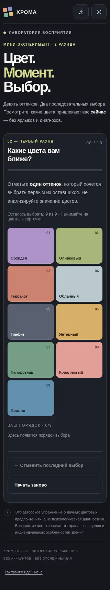
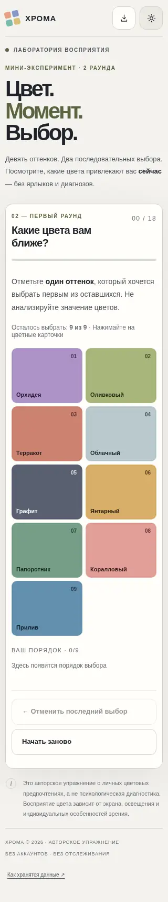
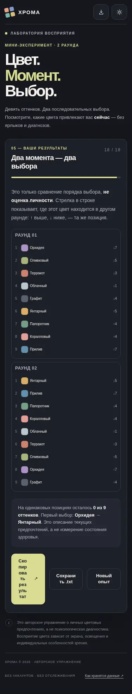

# ХРОМА — цветовой выбор

PWA для iPhone и Android и автономный Android APK (Android 6+). Это **не психологический или медицинский тест**, не копия Люшера и не диагностика. Собственная палитра из 9 оттенков, два независимых раунда, сравнение рангов без выводов о личности.

## Использование

- [Открыть PWA](https://vremennobeznika.github.io/enjigirling/chroma/) — Safari на iPhone → Поделиться → На экран Домой; Chrome на Android → Установить приложение или На главный экран.
- В Android APK работа полностью автономна, разрешение INTERNET не запрашивается. APK **debug/preview**; это не релиз Google Play, обновление через debug-ключ других runner-ов может потребовать удаления прежней версии.
- Последний корректный выбор сохраняется в несколько слотов, при ошибке одного восстанавливается из другого. Постоянная ошибка показывает экран восстановления без бесконечного автоперезапуска. Полная защита от всех сбоев устройства невозможна.

## Скриншоты (реальный Chromium, размеры экранов эмулированы)

| 320 px / тёмная | 320 px / светлая | 375 px / результат |
|---|---|---|
|  |  |  |

## Проверки

- `python chroma/tests/check_app.py` — базовые браузерные сценарии.
- `python chroma/tests/high_assurance_audit.py` — состояние, безопасность формулировок, контраст и доступность.
- `python chroma/tests/fault_matrix.py` — 10 аварийных групп (битые копии, квоты, рендер, 44 конфигурации экрана/темы/текста).
- `node chroma/tests/check_worker.js` — логика service worker.
- `HIGH_ASSURANCE_MATRIX.md` — P0/P1, явные MANUAL/BLOCKED. Физический iPhone и Android пока не проверены; клинические и юридические гарантии не заявляются.
- [GitHub Actions: сборка APK](../../actions/workflows/chroma-android.yml) — debug APK как артефакт успешной сборки.

## Структура

`index.html`, `app.js`, `styles.css`, `manifest.webmanifest`, `sw.js`, `assets/` — веб-версия. `android/` — нативная оболочка WebView с ограничением навигации. `.github` workflow расположен в корне репозитория. `screenshots/` — контрольные изображения, `tests/` — исходники и результаты автоматических проверок. `LEGAL.md` — юридические ограничения.

Сторонние шрифты, библиотеки, реклама, трекеры и аккаунты не используются. Исходники по лицензии MIT; права на чужие методики или бренды не предоставляются.
